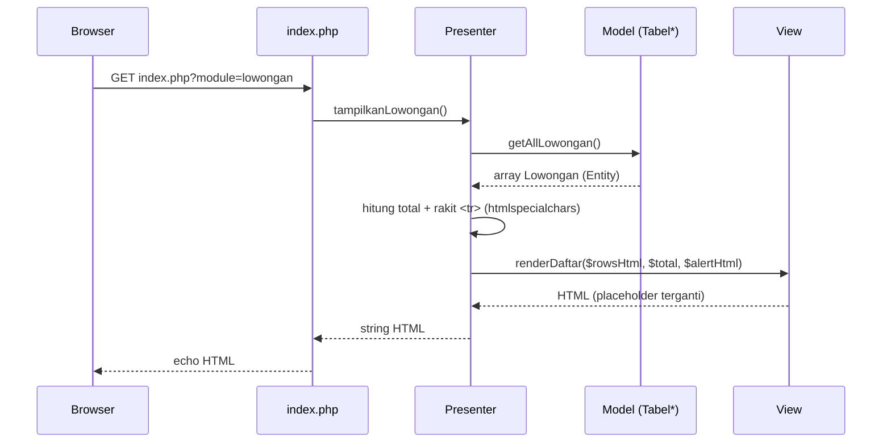

# TP9 DPBO — MVP (Model-View-Presenter) Strict Passive View
**Rekrutmen / HR:** modul **Kandidat** (starter, dilengkapi) + modul **Lowongan** (baru)

## Janji
Saya Bentar Bintang Umeir dengan nim 2509865 mengerjakan TP9 dalam mata kuliah DPBO untuk 
keberkahanNya maka saya tidak melakukan kecurangan seperti yang telah dispesifikasikan. Aamiin

Aplikasi web PHP Native + MySQL (PDO) untuk mengelola data **kandidat karyawan** dan **lowongan pekerjaan** dengan arsitektur **Model-View-Presenter (MVP) Strict Passive View**.

---

## 1. Struktur Repository

```
TP9DPBO2526C2/
├── project/
│   ├── index.php                      # front controller + routing
│   ├── models/
│   │   ├── DB.php                     # wrapper PDO (prepared statement)
│   │   ├── Kandidat.php               # Entity
│   │   ├── KontrakModel.php           # interface Model Kandidat
│   │   ├── TabelKandidat.php          # implementasi Model Kandidat
│   │   ├── Lowongan.php               # Entity (modul baru)
│   │   ├── KontrakModelLowongan.php   # interface Model Lowongan
│   │   └── TabelLowongan.php          # implementasi Model Lowongan
│   ├── presenters/
│   │   ├── Flash.php                  # pesan sukses/error + input lama (session, sekali pakai)
│   │   ├── KontrakPresenter.php       # interface Presenter Kandidat
│   │   ├── PresenterKandidat.php
│   │   ├── KontrakPresenterLowongan.php
│   │   └── PresenterLowongan.php
│   ├── views/
│   │   ├── KontrakView.php            # interface View Kandidat
│   │   ├── ViewKandidat.php
│   │   ├── KontrakViewLowongan.php
│   │   └── ViewLowongan.php
│   └── template/
│       ├── skin.html / form.html                    # Kandidat: daftar & form
│       └── skin_lowongan.html / form_lowongan.html  # Lowongan: daftar & form
├── dokumentasi/                       # screenrecord program berjalan
├── mvp_db.sql                         # struktur + dummy data (kandidat & lowongan)
└── README.md
```

## 2. Cara Menjalankan

1. Salin folder `project/` ke `C:\laragon\www\` (atau `htdocs\` XAMPP), mis. menjadi `www/MVP_Kandidat/`.
2. Nyalakan Apache & MySQL, lalu **import `mvp_db.sql`** lewat phpMyAdmin (membuat database `mvp_kandidat_db` berisi tabel `kandidat` dan `lowongan`). File ini aman di-import berulang kali (`CREATE TABLE IF NOT EXISTS` + `INSERT IGNORE`).
3. Buka `http://localhost/MVP_Kandidat/`.
4. Jika kredensial MySQL berbeda, ubah konstanta `DB_HOST`, `DB_NAME`, `DB_USER`, `DB_PASS` di bagian atas `index.php`.

Kebutuhan: PHP 8.0+ dengan ekstensi `pdo_mysql` (bawaan Laragon/XAMPP).

---

## 3. Desain Program

### 3.1 Arsitektur MVP Strict Passive View

```
                 ┌────────────────────────┐
   User Action   │       Presenter        │   Model Changed
 ───────────────▶│ • validasi & logika    │◀───────────────
                 │ • merakit baris <tr>   │
                 │ • menghitung total     │
                 └───────┬────────▲───────┘
            Update UI    │        │   Update / Query
      (string HTML jadi) │        │   (objek Entity)
                         ▼        │
                 ┌────────────┐  ┌┴───────────┐
                 │    View    │  │   Model    │
                 │ (pasif)    │  │ (PDO + SQL)│
                 └────────────┘  └────────────┘
                  View TIDAK mengenal Model / Entity
```

| Komponen | Tanggung jawab | Yang **tidak** boleh |
|---|---|---|
| **Model** (`Tabel*`, Entity) | Query database dengan *prepared statement*, memetakan baris ke objek Entity | Mengenal View / HTML |
| **View** (`View*`) | Membaca file template HTML dan mengganti *placeholder token* (`{{TABLE_ROWS}}`, `{{TOTAL_DATA}}`, `{{NAMA}}`, dst.) | `foreach`, `count()`, `require_once` Model/Entity, menerima array objek |
| **Presenter** (`Presenter*`) | Menerima input, validasi, memanggil Model, menghitung total, merakit potongan `<tr>…</tr>` (dengan `htmlspecialchars`), lalu memerintahkan View merender | Bergantung pada kelas konkret (selalu lewat interface) |

### 3.2 Kontrak / Interface

Seluruh komunikasi antar-lapisan melalui interface; `Presenter` hanya mengenal tipe interface, bukan kelas konkret.

| Modul | Model | View | Presenter |
|---|---|---|---|
| Kandidat | `KontrakModel` → `TabelKandidat` | `KontrakView` → `ViewKandidat` | `KontrakPresenter` → `PresenterKandidat` |
| Lowongan | `KontrakModelLowongan` → `TabelLowongan` | `KontrakViewLowongan` → `ViewLowongan` | `KontrakPresenterLowongan` → `PresenterLowongan` |

```php
// Presenter menerima kontrak, bukan implementasi konkret
public function __construct(KontrakModel $model, KontrakView $view)
public function __construct(KontrakModelLowongan $model, KontrakViewLowongan $view)
```

Perubahan kecil pada starter: `renderDaftar()` mendapat parameter opsional ketiga `string $alertHtml = ''` untuk pesan sukses/error (HTML sudah dirakit & di-escape Presenter, View hanya menggantinya ke `{{ALERT}}`). Form menerima alert lewat kunci `alertHtml` pada `$formData`.

### 3.3 Skema Database — `mvp_kandidat_db`

**`kandidat`**

| Kolom | Tipe | Keterangan |
|---|---|---|
| `id` | INT, PK, AUTO_INCREMENT | |
| `nama` | VARCHAR(100) | |
| `posisi` | VARCHAR(100) | posisi yang dilamar |
| `domisili` | VARCHAR(100) | |
| `skorTes` | INT, default 0 | 0–100 |
| `pengalamanTahun` | INT, default 0 | |

**`lowongan`** (modul baru)

| Kolom | Tipe | Keterangan |
|---|---|---|
| `id` | INT, PK, AUTO_INCREMENT | |
| `judul_posisi` | VARCHAR(100) | |
| `departemen` | VARCHAR(100) | |
| `lokasi` | VARCHAR(100) | |
| `kuota` | INT, default 1 | 1–1000 |
| `status` | ENUM('Dibuka','Ditutup','Ditunda'), default 'Dibuka' | |

Tabel `lowongan` sengaja **berdiri sendiri** (tanpa foreign key ke `kandidat`) agar modul tetap sederhana dan independen; relasi bersifat opsional pada ketentuan tugas.

---

## 4. Alur Program

### 4.1 Routing (`index.php`)

| Request | Hasil |
|---|---|
| `GET index.php` / `?module=kandidat` | Daftar kandidat (urut `skorTes DESC, id ASC`) |
| `GET ?screen=add` / `?screen=edit&id=N` | Form tambah / ubah kandidat (prefill) |
| `GET ?module=lowongan` | Daftar lowongan |
| `GET ?module=lowongan&screen=add` / `&screen=edit&id=N` | Form tambah / ubah lowongan |
| `POST` `action=tambah \| ubah \| hapus` (+ `module=lowongan` untuk lowongan) | Presenter memproses lalu **redirect** (pola Post-Redirect-Get) |

Navigasi antarmodul memakai tab **Data Kandidat** / **Data Lowongan** yang ada di semua template.

### 4.2 Alur Read (daftar)



### 4.3 Alur Create / Update / Delete

1. Form (`form.html` / `form_lowongan.html`) mengirim `POST` ke `index.php` dengan `action` = `tambah` atau `ubah` (hidden `id` untuk ubah). Tombol **Hapus** di tiap baris adalah form `POST` kecil dengan `action=hapus` dan konfirmasi `confirm()`.
2. `index.php` mengambil nilai `$_POST`, mengubah angka ke `int`, lalu memanggil method Presenter.
3. Presenter melakukan **trim + validasi**:
   - Kandidat: nama/posisi/domisili wajib (maks 100 karakter), skor 0–100, pengalaman 0–60 tahun.
   - Lowongan: judul/departemen/lokasi wajib (maks 100), kuota 1–1000, status harus salah satu dari `Dibuka`/`Ditutup`/`Ditunda` (whitelist).
4. **Jika tidak valid**: pesan error + input lama disimpan sebagai *flash* (session, sekali pakai), lalu redirect kembali ke form; form tampil dengan alert merah dan field terisi ulang.
5. **Jika valid**: Presenter memanggil Model (`add…`/`update…`/`delete…`, prepared statement), menyimpan pesan sukses sebagai flash, lalu redirect ke halaman daftar yang menampilkan alert hijau.
6. Untuk `ubah`/`hapus`, Presenter memastikan data dengan `id` tersebut ada; bila tidak, ditampilkan pesan *"Data … tidak ditemukan."*

### 4.4 Alur Form Update (prefill)

`tampilkanForm…($id)` → Model `get…ById($id)` → Presenter mengubah Entity menjadi **array nilai sederhana** (`$formData`) → `View::renderForm($judul, 'ubah', $formData)`. Untuk lowongan, daftar `<option>` status dirakit Presenter (`statusOptionsHtml`) sehingga opsi yang sesuai langsung `selected` tanpa logika di View.

---

## 5. Keamanan

| Ancaman | Penanganan |
|---|---|
| **SQL Injection** | Semua query lewat `DB::executeQuery($query, $params)` dengan *prepared statement* dan parameter bernama (`:id`, `:nama`, …); `PDO::ATTR_EMULATE_PREPARES => false` |
| **XSS** | Semua data dari database yang dicetak di baris tabel / alert di-escape dengan `htmlspecialchars()` di Presenter; nilai field form di-escape di View sebelum masuk atribut `value` |
| **Input tidak valid** | Validasi di Presenter, nilai `status` memakai whitelist, ID di-cast ke `int` |
| **Hapus lewat link (CSRF ringan)** | Aksi tulis hanya lewat `POST`, bukan `GET` |

---

---

## 6. Dokumentasi (Screenrecord)

### Tabel 


### CRUD Tabel Kandidat
#### Tambah Kandidat

https://github.com/user-attachments/assets/948ab2dc-8d9c-4bef-b8c8-380a8bbd5898

#### Update Kandidat

https://github.com/user-attachments/assets/df7b6eb8-a83b-4bde-bd13-5eeb3a844b38

#### Delete Kandidat

https://github.com/user-attachments/assets/c4659aa6-96ed-43e0-9b90-c11a717cfaa8


### CRUD Tabel Lowongan
#### Tambah Lowongan

https://github.com/user-attachments/assets/aaa02d91-df77-4013-891f-735e0c279b32

#### Update Lowongan

https://github.com/user-attachments/assets/1584ef4c-edaf-4200-ba4e-7780221047f3

#### Delete Lowongan

https://github.com/user-attachments/assets/b88702e4-f560-44c1-b78a-19c41112af12

